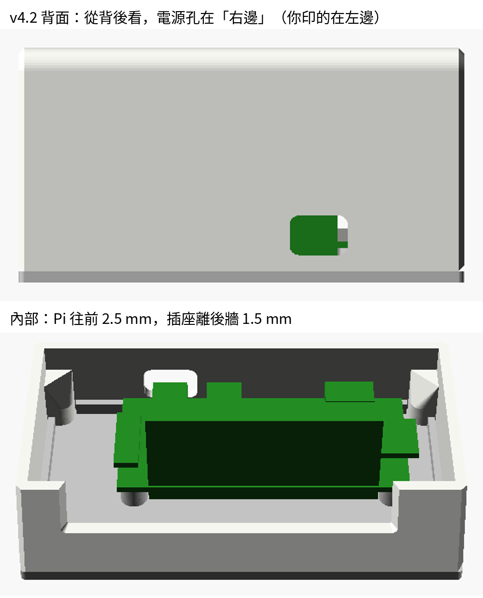

# 電子紙桌上看板 外殼 v4.2

Raspberry Pi Zero 2W ＋ Heltec 2.9" 電子紙（296×128）的桌上型外殼。
斜面 20° 的一體成形上蓋，加上一片可拆的底板。背面只露出一個 micro USB 電源孔。



## 檔案

| 檔案 | 用途 |
|---|---|
| `eink_display_v4.scad` | 原始設計檔（OpenSCAD）。**要修改請改這個檔**，STL 都是從它產生的 |
| `stl/shell_clean.stl` | 上蓋：極簡款（建議） |
| `stl/shell_retro.stl` | 上蓋：復古收音機款（螢幕凸框、頂面格柵、側邊溝槽） |
| `stl/shell_ribbed.stl` | 上蓋：細紋款（側面與背面直紋） |
| `stl/plate.stl` | 底板：Pi 銅柱、前方卡勾、隱藏式散熱孔 |
| `stl/eink_fit_test.stl` | 試印片：只有螢幕視窗和定位角，先印這片確認電子紙放得進去（約 10 分鐘） |

上蓋三款只差外觀，內部尺寸完全相同，底板三款共用。

## 列印

| 項目 | 建議 |
|---|---|
| 材料 | PLA 或 PETG |
| 層高 | 0.2 mm |
| 牆數 | 3（2.4 mm 外牆剛好是 0.4 mm 噴嘴的 6 條線） |
| 填充 | 15～20% |
| 支撐 | **不需要** |
| 擺放 | 上蓋「頂面朝下」，底板平放（STL 已經擺好，直接切片即可） |

> **注意（v4.2 修正）**：v4.1 以前的上蓋 STL 是用鏡像翻面的，印出來左右相反：電源孔會在錯的一邊，螢幕視窗也偏了約 5 mm。
> v4.2 改用旋轉翻面。從背面看，電源孔應該在**右下方**。如果你印的在左下方，就是舊版檔案。

## 需要的零件

| 零件 | 數量 | 用途 |
|---|---|---|
| M2.5×5～6 自攻螺絲 | 4 | Pi 鎖到底板銅柱 |
| M2.5×6 沉頭自攻螺絲 | 2 | 底板鎖到上蓋後方螺絲柱 |
| Ø8 mm 矽膠腳墊 | 4 | 底板四角（後面兩個剛好蓋住螺絲頭） |
| 雙面膠（VHB 或泡棉膠，0.5～1 mm） | 少許 | 電子紙玻璃邊框貼在視窗四周 |
| 杜邦線（母對母） | 7 | 電子紙接 Pi GPIO，接線見專案根目錄的 README |

## 組裝

1. **電子紙**：在視窗四周的邊框貼一圈雙面膠，**不要貼到顯示區**。把模組放進 4 個 L 形定位角，讓排針朝右（從正面看），然後壓緊。
2. **Pi**：零件面朝上、接頭朝後，用 4 顆 M2.5 自攻螺絲鎖在底板銅柱上。
3. **接線**：照接線圖插好 7 條杜邦線，再插上 microSD 卡。
4. **蓋上**：先把底板前緣的 2 個卡勾斜斜勾進上蓋前牆，再把後面往上翻、蓋平。
5. **鎖螺絲**：從底部鎖 2 顆沉頭螺絲到後方螺絲柱，最後貼上 4 個腳墊。

蓋上時 micro USB 插座離後牆約 1.5 mm，從斜著勾入到蓋平的整個過程都不會刮到。這點已經用模型模擬確認過。

## 修改設計

```
openscad -D 'part="shell"' -D 'style="clean"' -o shell_clean.stl eink_display_v4.scad
openscad -D 'part="plate"' -o plate.stl eink_display_v4.scad
openscad -D 'part="assembled"' eink_display_v4.scad   # 開 GUI 看組裝狀態
```

常改的參數都在檔案開頭：
- `style`：上蓋外觀。
- `ang`：斜面角度。
- `tape_t`：雙面膠厚度。
- `conn_clr`：插座到後牆的間隙。
- `hdmi_port = true`：在背面多開一個 mini HDMI 孔。

## 授權

本目錄的外殼設計（`.scad` 原始檔、`.stl` 模型、圖片與本說明）採用
**[創用 CC 姓名標示-非商業性 4.0 國際授權（CC BY-NC 4.0）](https://creativecommons.org/licenses/by-nc/4.0/deed.zh-hant)**。

[](https://creativecommons.org/licenses/by-nc/4.0/deed.zh-hant)

- ✅ **可以**：自己列印使用、分享、修改、在這個設計的基礎上重新創作。
- 📝 **條件**：要標示原作者，例如「外殼設計：Michael（github.com/MichaelEE0318/einkboard）」，並提供授權連結、註明是否有修改。
- 🚫 **不可以**：用於商業目的。例如販售印好的外殼、販售 STL 檔、當作商品的一部分出售。

需要商業授權請聯絡作者。完整條款見 [LICENSE](LICENSE)。

© 2026 Michael（MichaelEE0318）
